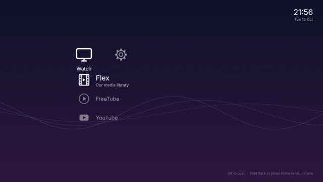
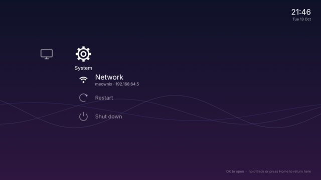
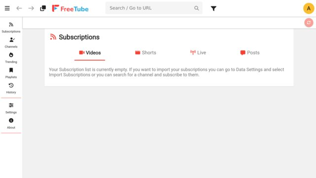
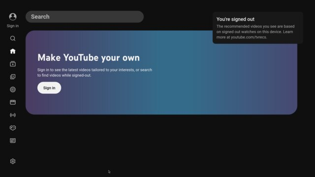

# meownix

<a href="screenshots/menu.jpg"></a>
<a href="screenshots/system.jpg"></a>
<a href="screenshots/freetube.jpg"></a>
<a href="screenshots/youtube.jpg"></a>

A tiny Linux system for the mini PC under our projector. It boots straight into a
console-style menu, you pick what you want to watch with the remote, and it opens
fullscreen. That's it.

The PC used to run Windows, which was hilariously slow on it, and every time we sat
down to watch something there was a login screen, an update, a popup, or a window
that needed a mouse to get rid of. I wanted something that just turns on and lets us
watch stuff.

So meownix:

- **Boots straight into the menu.** No login screen, no desktop, nothing to click past.
- **Only has the apps we actually use.** [Flex](https://github.com/catchouli/flex) for
  our own library, [FreeTube](https://freetubeapp.io/) for YouTube, and YouTube's TV
  interface in a browser for when FreeTube breaks.
- **Works from the couch.** Everything's usable with an air-mouse remote: arrows, OK
  and back. Apps open fullscreen and are scaled up so you can read them from across
  the room.
- **Always gets you back to the menu.** Hold Back (or press Home) and whatever's open
  closes, even if it's frozen.

It's built for a Minix NGC-1, but it should run on pretty much any Intel mini PC.

## How it works

It's plain Debian with almost everything taken out. When it boots it logs straight
into a [cage](https://github.com/cage-kiosk/cage) session, a tiny compositor that
just shows one thing fullscreen, and that runs the menu. The menu is a small Rust
app ([egui](https://github.com/emilk/egui)) that launches each app on top of itself
and shows up again when the app closes.

What's in the menu lives in [`menu/menu.toml`](menu/menu.toml), so adding another
app (or pointing Flex at your own server) is a couple of lines.

## Getting it running

You'll need Docker. Then:

```sh
./build.sh
```

That builds `out/meownix-amd64.iso`, which you can write to a USB stick and boot
from. Check the disk number with `diskutil list` first, because this wipes it:

```sh
diskutil unmountDisk /dev/diskN
sudo dd if=out/meownix-amd64.iso of=/dev/rdiskN bs=4m status=progress
```

On Linux it's the same `dd`, with `/dev/sdX` from `lsblk`.

To try it out in a VM first (on a Mac), `brew install vfkit`, then
`./build.sh arm64` and `vm/run.sh`. It's the same system built for ARM, so it runs
at full speed on Apple Silicon.

## Remote controls

Left and right switch between Watch and System, up and down pick an app, OK opens it.
Hold Back for a second, or press Home, to close the app and go back to the menu.

Restart and Shut down are under System, and you have to press OK twice so nobody
turns it off by accident. System also shows the box's IP address.

## Credits

meownix is mostly glue around other people's great work:
[Debian](https://www.debian.org/) and
[live-build](https://salsa.debian.org/live-team/live-build), cage, egui,
[Firefox](https://www.mozilla.org/firefox/),
[uBlock Origin](https://github.com/gorhill/uBlock), FreeTube and the
[Inter](https://rsms.me/inter/) font. The boot menu templates in
`live/config/bootloaders` come from live-build (GPL-3.0-or-later). FreeTube is
downloaded during the build and isn't part of this repo.

## License

MIT, see [LICENSE](LICENSE), apart from those boot menu templates, which stay
GPL-3.0-or-later.
