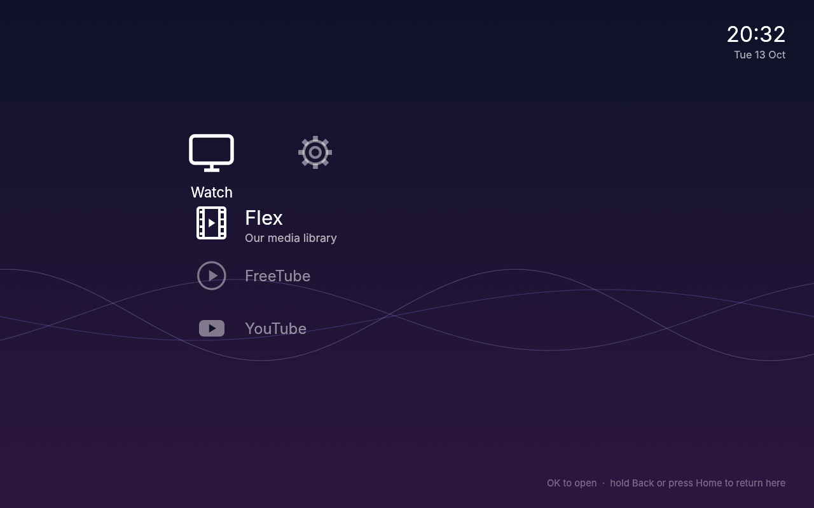
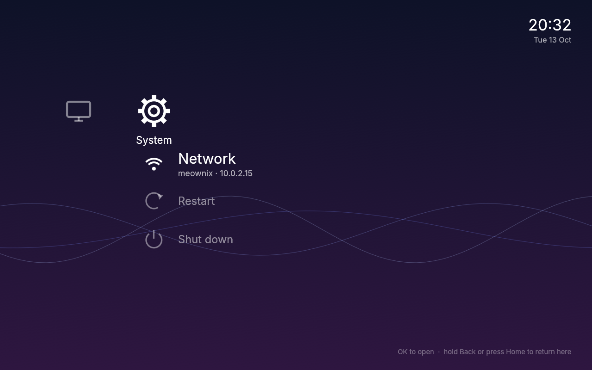
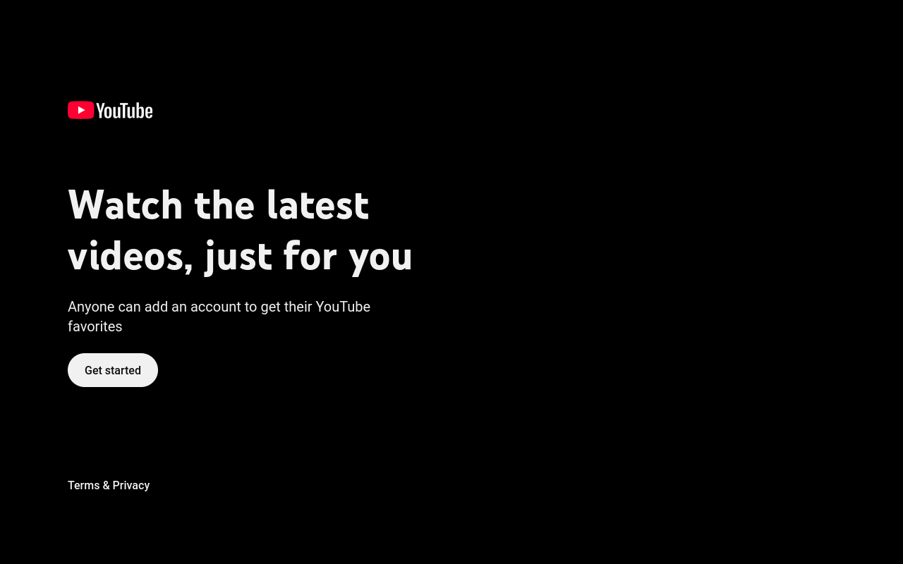

# meownix

A tiny Debian-based system that turns a mini PC into a TV box. It boots
straight into a console-style crossbar menu (no login screen, no desktop)
and launches the apps we actually watch things with, fullscreen:
[Flex](#apps) for our own media library, [FreeTube](https://freetubeapp.io/),
and YouTube's TV interface. Everything works from an air-mouse remote with
just the arrow keys, OK and Back.

It's built for a Minix NGC-1 driving a projector, but should run on most
Intel-based x86_64 mini PCs.



| | |
|---|---|
|  |  |
| System menu | YouTube's TV interface |

## Using it

| Remote | Does |
|---|---|
| ◀ ▶ | Switch category |
| ▲ ▼ | Choose an app |
| OK | Open it |
| Hold **Back** (1s) or press **Home** | Close the app and return to the menu |

Restart and Shut down ask you to press OK twice, so a stray press can't turn
the box off. The System menu also shows the box's network address.

## How it fits together

```
UEFI → GRUB → Debian live (trixie, amd64)
  └─ getty autologin on tty1 as `tv`
       └─ ~/.profile → meownix-session
            └─ cage (Wayland kiosk compositor)
                 └─ meownix-menu (Rust + egui)
                      ├─ meownix-browser flex …     Firefox kiosk, own profile
                      ├─ freetube
                      └─ meownix-browser youtube …  youtube.com/tv with a TV user agent
```

- **cage** shows its newest window fullscreen. The menu launches an app, the
  app's window covers the menu, and when it closes the menu is visible again.
- **meownix-menu** reads input devices directly to catch the Back/Home keys,
  so it can close whatever app is open even when it doesn't have focus.
  Apps run in their own process group, so closing one also closes its helpers.
- Each browser app gets its **own Firefox profile**, so logins and settings
  don't mix. Firefox has uBlock Origin, DRM enabled, telemetry off.
- **No Python, no desktop**: the image is Debian with recommends off, plus
  exactly the packages in [`live/config/package-lists`](live/config/package-lists/meownix.list.chroot).

### Apps

Everything in the menu comes from [`menu/menu.toml`](menu/menu.toml): add a
category or an item with a name, an icon and the command to run. Flex is our
self-hosted media server; point its entry at your own server, or swap it for
anything with a web interface.

## Building

You need Docker. Everything else runs in containers.

```sh
./build.sh          # out/meownix-amd64.iso: the image for the real (x86_64) box
./build.sh arm64    # out/meownix-arm64.iso: same system for fast VMs on Apple Silicon
./build.sh menu     # just compiles the menu
```

Both images come from the same config. The arm64 one leaves out the
Intel-only firmware and drivers. On an Apple Silicon Mac the x86_64 image is
built under emulation and takes 15–30 minutes; the arm64 one builds natively.

### Working on the menu

The menu runs as a normal window on macOS or Linux, which is much faster
than rebuilding the image:

```sh
cd menu
cargo run -- --windowed --dry-run --config menu.toml
```

`--dry-run` pretends to launch apps instead of running them. Esc quits.

### Trying it in a VM

```sh
brew install qemu
vm/run.sh           # full screen, UEFI like the real box (Ctrl+Opt+F leaves full screen)
vm/run.sh window    # in a window instead
```

On Apple Silicon this boots the arm64 image with Apple's hypervisor, which
runs at close to native speed. `vm/run.sh amd64` boots the real x86_64
image, but under emulation it manages about one frame a second, so it's only
good for checking that the image boots.

`vm/run.sh headless` runs without a window, and `vm/ctl.py` can take
screenshots and press keys; that's how the screenshots above were made.

### Putting it on a USB stick

Check the disk number with `diskutil list` (macOS) or `lsblk` (Linux) first:
this overwrites the whole stick.

```sh
# macOS
diskutil unmountDisk /dev/diskN
sudo dd if=out/meownix-amd64.iso of=/dev/rdiskN bs=4m status=progress

# Linux
sudo dd if=out/meownix-amd64.iso of=/dev/sdX bs=4M status=progress conv=fsync
```

## Layout

| Path | What |
|---|---|
| [`menu/`](menu) | The crossbar menu (Rust/egui) and its `menu.toml` |
| [`live/`](live) | live-build config: package list, build hook, files copied into the image, GRUB templates |
| [`builder/`](builder) | Docker images for building (live-build, Rust cross-compiler) |
| [`vm/`](vm) | Run and drive the ISO in QEMU |
| [`build.sh`](build.sh) | Builds `out/meownix-amd64.iso` |

## Debugging on the box

Ctrl+Alt+F2 gives a console: log in as `tv`, no password (passwordless sudo
while we're developing). Ctrl+Alt+F1 goes back to the TV.

- `evtest` shows what keys the remote sends; put their names in
  `menu.toml` under `[controls]`.
- The session log is `~/.local/state/meownix/session.log`.

## Credits

meownix is glue around other people's excellent work:
[Debian](https://www.debian.org/) and its
[live-build](https://salsa.debian.org/live-team/live-build),
[cage](https://github.com/cage-kiosk/cage),
[egui](https://github.com/emilk/egui),
[Firefox](https://www.mozilla.org/firefox/),
[uBlock Origin](https://github.com/gorhill/uBlock),
[FreeTube](https://github.com/FreeTubeApp/FreeTube) and the
[Inter](https://rsms.me/inter/) typeface.

The GRUB templates in `live/config/bootloaders/grub-pc` are adapted from
live-build (GPL-3.0-or-later). FreeTube is downloaded at build time and is
not part of this repository. YouTube is a trademark of Google; meownix is not
affiliated with Google, Sony or anyone else.
